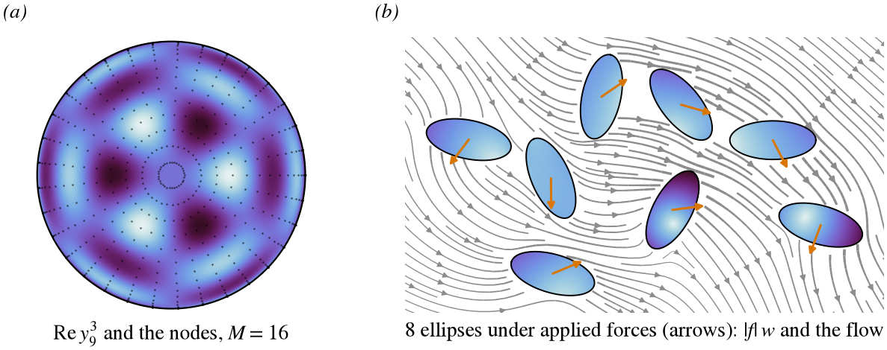
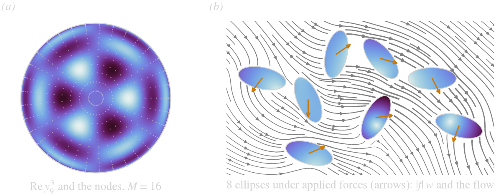

# ProjectedSphericalHarmonics.jl




*(a)* ``\mathrm{Re}\, y_9^3`` with the grid of `disk(16)`. *(b)* Eight ellipses (``a/b = 1/0.45``, ``M = 16``) under unit forces (arrows) and random torques, from `suspension_mobility_solve`: each body is colored by ``|f|\,w``, its force density without the edge singularity, and the streamlines show the flow they induce (by the closed form near each body).

ProjectedSphericalHarmonics solves integral equations on flat open surfaces (a disk, an ellipse, or a domain
bounded by a smooth curve, in the plane ``z = 0``) to spectral accuracy. It uses one basis throughout: the
*projected spherical harmonics* (PSH), spherical harmonics on the hemisphere projected onto the unit disk,

```math
y_\ell^m(r, \theta) = N_\ell^m\, P_\ell^{|m|}\!\left(\sqrt{1 - r^2}\right) e^{im\theta}.
```

On the unit disk they diagonalize the single layer and hypersingular operators of the 3D Laplacian, with
eigenvalues in closed form, and they carry the edge behavior of the solutions. With ``w = \sqrt{1 - r^2}``, the
density of a first-kind equation behaves like ``1/w`` at the rim and a double-layer density like ``w``. Writing
both as a PSH series times a power of ``w`` gives exponential convergence, with no special quadrature at the
edge. The package uses this to provide:

- **Laplace layer potentials and their inverses.** The single layer ``\mathcal{S}``, the hypersingular operator
  ``\mathcal{N}``, their inverses, and the Poisson problem on the disk, all in a few FFTs and recurrences.
- **Stokes flow in the plane.** The single layer of in-plane Stokes flow on a surface between two fluids, its
  inverse, and the mobility problem of one rigid body: the velocity and rotation rate under given forces, torque
  and background flow.
- **Non-circular domains.** Ellipses, by an affine map of the disk, and domains bounded by a smooth curve, by a
  harmonic or conformal map (experimental). The singular part of each operator stays the disk's, so the accuracy is still spectral.
- **Many-body suspensions.** Mobility problems for many disks or ellipses at once, solved with GMRES. The
  interactions between bodies are summed by Ewald splitting with NUFFTs or by FMM, and corrected by a closed form
  where bodies come close.

## In one call

```julia
using ProjectedSphericalHarmonics

D = disk(32)                        # the unit disk, degrees and orders up to 32

σ = 𝒮⁻¹(1, D)                       # charge density of a disk held at unit potential
integral(σ, D)                      # its total charge: 8 (the capacitance of a disk, 8ε₀a), to 1e-12

f = 𝒮_st⁻¹((1.0, 0.0), D)           # force density on a disk translating at unit speed
integral(f[1], D)                   # its drag: 16/3 under a stress-free surface, to 1e-12
```

## What it offers

| | |
|:--|:--|
| Discretizations | `disk(Mℓ, Mₘ)`, `ellipse(a, b, Mℓ, Mₘ)`, `domain(γ, Mℓ, Mₘ)` (a harmonic or conformal map from samples of the boundary; experimental) |
| Basis | `ylm`, `λlm`, `Nlm`; transforms `psh` and `ipsh` (even or odd parity), `upsample`, `trace`, `integral` |
| Laplace | single layer `𝒮`, hypersingular `𝒩`, their inverses, `𝒮𝒩⁻¹`; Poisson `Δ⁻¹`; volume potentials `𝒱`, `𝒯_vol`, `ℬ`, `𝒯`; shape derivatives `δ𝒮`, `δ𝒩`, `δ𝒱`, `δℬ` |
| Differential operators | `∂ζ`, `∂ζ̄`, `∂x`, `∂y`, `grad`, `div`, `lap`, `∂n` (on the disk) |
| Stokes | single layer `𝒮_st` and its inverse, `stokes_mobility_matrix`, `stokes_mobility_solve`; two viscosities, `μ_bottom` and `μ_top` |
| Suspensions | `suspension_mobility_solve`, `suspension_velocity_solve`, `suspension_velocity_eval`; fast sums by Ewald + NUFFT or FMM3D, closed-form close evaluation for disks and ellipses |

## Where to go next

- [Getting started](@ref): installation, a discretization, transforms, the Laplace and Stokes operators,
  non-circular domains, and suspensions.
- [Method](@ref "Method overview"): the basis, the Laplace and Stokes operators, the maps to other domains, the
  suspension solver, and the limits.
- [Examples](@ref): scripts that solve against exact solutions.
- [API reference](@ref) and the [Code map](@ref): every function, and which feature runs it.
