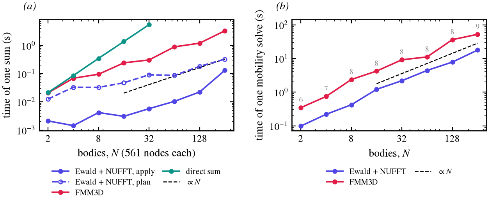
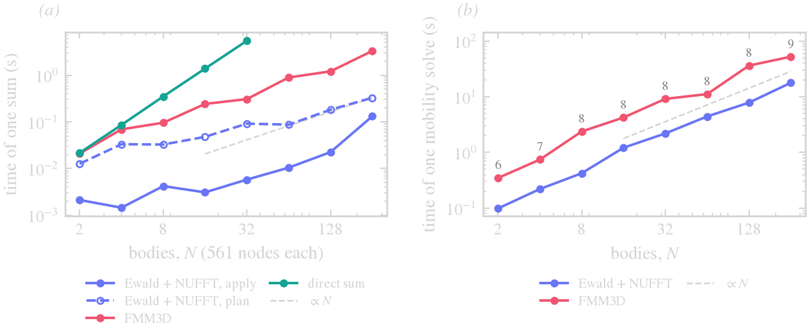

# [Suspensions](@id method-suspensions)

## The many-body mobility problem

`suspension_mobility_solve(xcm, θcm, uinf, uslip, F, Ω)` solves the mobility problem of ``N`` rigid bodies. Every
body is a copy of one discretization `Ω`, centered at `xcm[i]` and rotated by `θcm[i]`. For each body ``i``, its
force density ``f_i`` and rigid motion ``U_i = (U_x, U_y, \omega)`` satisfy

```math
\sum_j \mathcal{S}_\mathrm{st}^{ij}[f_j] + u_\infty = U_i + \omega_i\,(-y, x) + u_{s,i} \ \text{ on body } i, \qquad
\int f_i\, dA = (F_x, F_y)_i, \quad \int (x f_{i,y} - y f_{i,x})\, dA = T_i,
```

where ``\mathcal{S}_\mathrm{st}^{ij}`` is the Stokes single layer from body ``j`` evaluated on body ``i``. Each
body's quantities are kept in its own frame, that of the unrotated `Ω`:
- the force densities `f[i]`, the velocities on the grid, and the unknown ``U_i``;
- `uinf` and `uslip`, evaluated at the bodies' world positions and then rotated into each body's frame;
- the applied forces `F[i]`, also rotated into each body's frame.

The returned ``U_i`` is rotated back to the world frame.

The unknowns of the GMRES solve are the even PSH coefficients of ``w f_i`` (the representation in which
`𝒮_st` is sparse) and the ``U_i``. The equations are the PSH coefficients of each body's boundary condition, and
the force and torque balances. Each GMRES iteration applies the operator once and the preconditioner once.

## Applying the operator

The self term ``\mathcal{S}_\mathrm{st}^{ii}`` is the spectral single layer `𝒮_st`, the same as for one body.

The cross terms ``i \ne j`` are integrals over separated bodies, and their kernels are smooth. They are summed in
one pass over the grid nodes of all bodies. Each node carries the stokeslet ``f\, dz`` in the world frame, and the
pass computes

```math
u(x_p) = \sum_{q \ne p} G(x_p - x_q)\, f_q\, dz_q
```

at every node, by a fast method (`method`, tolerance `eps`). This sum also contains each body's own nodes, which
`𝒮_st` has already counted. That within-body block is subtracted. Since every body shares `Ω` and the Stokeslet
rotates with the body (``G(R\mathbf{r}) = R\,G(\mathbf{r})R^T``), the block is the same matrix for every body in its
own frame. `suspension_self_matrix(Ω)` builds it once (``2N_z \times 2N_z``, with ``N_z`` the grid points of one
body; 10 MiB at `disk(16,16)`, 36 MiB at `disk(32,16)`), and the subtraction is one threaded matrix product for all
bodies.

**Ewald summation** (`method = :ewald`, the default) splits ``1/\rho = \mathrm{erf}(\rho/\sigma)/\rho +
\mathrm{erfc}(\rho/\sigma)/\rho`` and the Stokeslet with it:
- **Long range.** The smooth part is multiplied by a window that is 1 over the bodies' bounding box, so its free-space
  convolution equals a periodic one on a box twice as large. Each apply is a type-1 NUFFT (FINUFFT), a ``2 \times
  2`` multiplication of the Fourier coefficients, and a type-2 NUFFT. The Fourier multiplier is computed once per
  plan.
- **Short range.** The short-range part decays like ``\mathrm{erfc}``, and is summed over pairs closer than
  ``c\sigma`` with ``\mathrm{erfc}(c) \approx`` `eps`, through a sparse matrix built once.
- **Splitting length.** ``\sigma`` is set so that each node has about 150 short-range neighbors.

`StokesEwald(sources; tol)` is the plan, which depends only on the node positions. A solve builds it once and reuses
it at every GMRES iteration. **FMM** (`method = :fmm`) calls FMM3D's Stokes FMM at every iteration instead.

**Close evaluation.** The node sum is accurate only at targets farther from the source body than a few grid
spacings. For disks and ellipses, the cross term at targets near another body is replaced by a closed form: the
single layer of the source body continued off the body, as a series in the exterior elliptic coordinates of the
target with hypergeometric radial factors. Each PSH mode of the source density maps to these closed forms, so
the replacement is exact for the body's expansion at any separation. A target of body ``i`` is corrected for
source body ``j`` when its distance from ``j``, measured in ``j``'s elliptic coordinates, is below
``c\,h\,\kappa``:
- ``h = 2\pi/(2M_m + 1)`` is the azimuthal grid spacing;
- ``\kappa`` is the aspect ratio of the ellipse;
- ``c`` = `close_radius` (`CLOSE_RADIUS = 8` by default).

The default ``c`` is set for about 1e-8 at ``M = 16``; it does not change with `eps`. The pairs and their maps are
built once per solve, and applied at each iteration in parallel over pairs.

| aspect ratio | ``M`` | ``c = 4`` | ``c = 6`` | ``c = 8`` |
|:--|:--|:--|:--|:--|
| 1 | 16 | 4e-6 | 2e-7 | 1e-8 |
| 1 | 32 | 9e-9 | 8e-11 | 2e-12 |
| 10 | 16 | 2e-7 | 2e-9 | 5e-11 |
| 10 | 32 | 1e-9 | 5e-12 | 3e-14 |

Relative error of the node sum at the edge of the corrected zone, ``c\,h\,\kappa`` from the body, for a smooth
random density (from `CLOSE_RADIUS`). Targets closer than that are corrected; targets farther away have at most
this error.

## The preconditioner

GMRES is preconditioned by the single-body problem of each body, independently: the block diagonal of the
operator. Each block is the mobility problem of one body. Writing ``K`` for the coefficient-space Stokes
matrix, ``\tilde r`` for a residual's coefficients, ``r_U`` for its force and torque part, and ``e_k`` for the
three rigid motions, the block's solution is

```math
g = K^{-1}\tilde r, \qquad R = M^{-1}\left(r_U - \mu\, B g\right), \qquad
\delta\tilde f = \mu\, g + \sum_k R_k\, \mu K^{-1}\hat e_k.
```

Here ``B g`` is the force and torque of the density ``\mathrm{ipsh}(g)/w``, ``\hat e_k`` are the coefficients of
``e_k``, and ``M`` is the single-body resistance matrix. A solve factors ``K`` once and precomputes the three
``\mu K^{-1}\hat e_k``. Each body's block then costs one sparse triangular solve and one inverse transform.
On a square lattice of unit disks with gaps of 0.6, at `gmrestol = 1e-8`, GMRES took 7 iterations for 2 bodies
and 8 for every count from 8 to 128: the count did not grow with the number of bodies.

## Costs




Unit disks (`disk(16,16)`, 561 nodes each) on a jittered square lattice with gaps of about 1, laptop, 8 Julia and 8 OpenMP threads, with other work on the machine (timings within about 2×). *(a)* One sum over all nodes at `eps = 1e-6`. At 128 bodies (71,808 nodes) the Ewald apply takes 0.022 s and its plan 0.18 s, against 1.2 s for FMM3D; the direct sum takes 5.5 s already at 32 bodies. *(b)* One `suspension_mobility_solve` at `eps = gmrestol = 1e-8`, with `M` and `S_self` precomputed and close evaluation on; the numbers are GMRES iterations (6 to 9, the same for both sums). With Ewald, 2.2 s at 32 bodies and 18 s at 256; with FMM3D, 3–5 times longer. At 256 bodies an iteration takes about 2 s while one Ewald sum takes 0.5 s: the per-body work (transforms, self terms, close-evaluation corrections) dominates.

**What depends on what.**

| Depends on | Built by | When |
|:--|:--|:--|
| The body shape `Ω` only | `stokes_mobility_matrix(Ω)` (`M`), `suspension_self_matrix(Ω)` (`S_self`) | Once per simulation: pass them as `M` and `S_self` |
| The configuration `xcm`, `θcm` | the Ewald plan, the close-evaluation pairs | Once per solve, by the solve itself |
| Neither | the factorization of ``K`` for the preconditioner (a few ms) | Once per solve, by the solve itself |

The fast sums, the close-evaluation correction and the subtraction are threaded. Start Julia with threads. FINUFFT
and FMM3D also run their own OpenMP threads. The package turns off FFTW.jl's Julia-threads callback when it loads,
because FINUFFT's threaded FFTs cannot run under it. A multithreaded BLAS call between these steps can slow them
down: its threads keep spinning, and compete with the OpenMP threads that follow. The suspension code therefore
avoids BLAS in its loops. If your own code calls BLAS between solves, setting `LinearAlgebra.BLAS.set_num_threads(1)`
may help.
